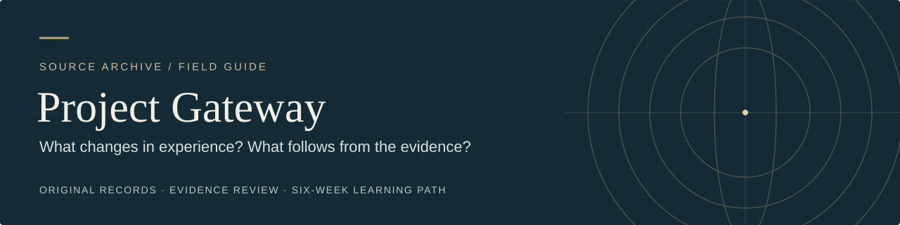
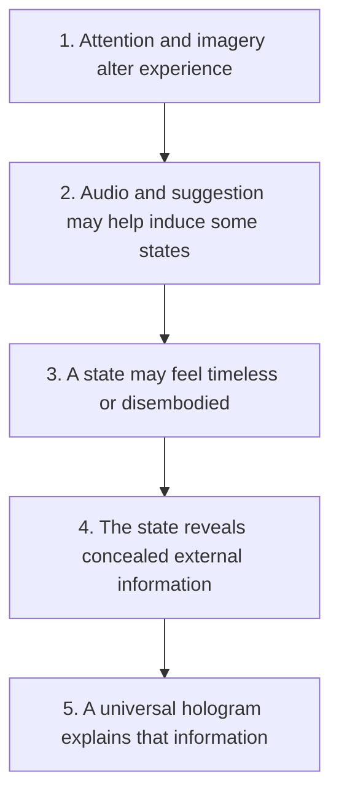

# Gateway Process — Evidence Review & Source Archive

**Curiosity without credulity. Skepticism without dismissal.**

An Army officer tried to explain altered consciousness through psychology, sound, physics, and a universal hologram. This archive lets you follow the original argument, examine the evidence, and explore what remains unresolved.

[Start here](START_HERE.md) · [Evidence at a glance](research/EVIDENCE_AT_A_GLANCE.md) · [Glossary](research/GLOSSARY.md) · [Six-week learning path](practice/LEARNING_PATH.md)

## Choose your path

Pick a question. Each route leads to material available in this repository.

| You want to… | Start here | Continue with |
|---|---|---|
| Understand the story in ten minutes | [Start here](START_HERE.md) | [FAQ](FAQ.md) |
| Read the original document | [Transcript and page navigation](transcript/03_Gateway_Process_Editable_Transcript.md) | [Source history and page 25](research/PROVENANCE_AND_EDITORIAL_NOTES.md) |
| Evaluate the science | [Evidence at a glance](research/EVIDENCE_AT_A_GLANCE.md) | [Full evidence review](research/04_Gateway_Process_Evidence_Review_and_Learning_Guide.md) and [sources](research/SOURCES.md) |
| Make sense of unfamiliar language | [Glossary](research/GLOSSARY.md) | [Gateway concepts translated](research/04_Gateway_Process_Evidence_Review_and_Learning_Guide.md#gateway-concepts-translated-into-testable-language) |
| Explore sleep and unusual body experiences | [Sleep, lucid dreams, and OBE](research/04_Gateway_Process_Evidence_Review_and_Learning_Guide.md#sleep-lucid-dreams-and-out-of-body-experience) | [Audio and Hemi-Sync](research/04_Gateway_Process_Evidence_Review_and_Learning_Guide.md#audio-entrainment-and-hemi-sync) |
| Examine remote viewing | [External verification and the 1995 disagreement](research/04_Gateway_Process_Evidence_Review_and_Learning_Guide.md#remote-viewing-and-the-standard-of-external-verification) | [Research roadmap](research/RESEARCH_ROADMAP.md) |
| Follow a structured course | [Six-week learning path](practice/LEARNING_PATH.md) | [Session journal](practice/SESSION_JOURNAL_TEMPLATE.md) |
| Check a claim or contribute | [Methodology](research/METHODOLOGY.md) | [Contributing](CONTRIBUTING.md) |

## What is this document?

On 9 June 1983, Lt. Col. Wayne M. McDonnell submitted *Analysis and Assessment of Gateway Process* within the U.S. Army Intelligence and Security Command. It attempts to explain the Monroe Institute's Gateway Experience through meditation, hypnosis, biofeedback, binaural audio, neuroscience, physics, parapsychology, and religious philosophy.

A copy later entered CIA archival holdings. **An Army assessment later released through CIA records** is the accurate description; declassification establishes access and provenance, not scientific endorsement. See the [government catalog](https://www.govinfo.gov/app/details/GOVPUB-D101-PURL-gpo152943) and [editorial notes](research/PROVENANCE_AND_EDITORIAL_NOTES.md).

The archive keeps the historical record, modern analysis, and learning activities distinct. Claims in the transcript retain the author's wording; corrections and present-day interpretation belong in the review.

## The question changes as you climb

The evidence is strongest for changes in experience. Each further claim needs its own test. A neural response to a sound does not establish whole-brain synchronization; a vivid experience does not establish access to hidden facts.

| Topic | Reading supported by this review | Boundary |
|---|---|---|
| Relaxation, attention, imagery | These can change subjective experience | Gateway Focus labels are not independently validated universal brain states |
| Binaural beats and Hemi-Sync | Auditory responses occur; outcome findings are mixed and context-dependent | Generic audio studies do not validate the whole Gateway course |
| OBE and lucid dreaming | Altered self-location and verified lucid dreams can occur | External perception requires separate concealed-target evidence |
| Remote viewing | Positive reports and methodological disputes coexist | The reviewed intelligence program did not establish dependable operational use |
| Resonance, quantum language, holograms | These include real scientific concepts | Their existence does not demonstrate McDonnell's proposed mechanism |

Read the [full evidence map](research/EVIDENCE_AT_A_GLANCE.md) for distinctions, then follow its links to studies and limitations. This is a targeted review, not an exhaustive systematic review of Gateway or a fresh search of every publication.

## Open the archive

| Resource | What you will find |
|---|---|
| [Government-preserved facsimile · PDF, 3.2 MB](source/01_Source_GovInfo_CIA_Release.pdf) | 29 scanned leaves; printed pages 17/18 are reversed and printed page 25 is absent |
| [Supplementary complete facsimile · PDF, 7.7 MB](source/02_Supplement_Complete_Copy_With_Page_25.pdf) | A separately sourced 30-leaf copy containing printed page 25 |
| [Editable transcript · Markdown](transcript/03_Gateway_Process_Editable_Transcript.md) | Reading order restored, original exhibits, and explicit page provenance |
| [Evidence review · Markdown](research/04_Gateway_Process_Evidence_Review_and_Learning_Guide.md) | Claim-by-claim discussion, linked citations, and study limitations |
| [Source guide](research/SOURCES.md) / [structured inventory · JSON](research/05_Research_Source_Inventory.json) | Bibliographic records, access status, findings, and limits for 38 sources |

The reason page 25 is absent from the government copy is not established here. The omission is a provenance question; the supplementary page is labeled rather than silently substituted.

Word downloads and format notes

- [Transcript · Word](transcript/03_Gateway_Process_Editable_Transcript.docx)
- [Evidence review · Word](research/04_Gateway_Process_Evidence_Review_and_Learning_Guide.docx)

These are preserved September 2026 editions. Markdown contains the current navigation and editorial updates. Source PDFs are in the **source** folder, even where the older Word edition describes them as adjacent files. Use the facsimiles to check historical wording. The glossary and course stay in Markdown so readers can open, search, copy, and link to them without downloading an app.

## Explore with a record

The [learning path](practice/LEARNING_PATH.md) offers reading and optional short exercises. No purchase or acceptance of the memorandum's cosmology is required. Keep three questions separate:

1. What did I experience?
2. What mechanism might explain it?
3. Did it reveal independently verifiable information?

Record observations before interpretation and predictions before feedback. Assess ordinary-life outcomes such as concentration, sleep, completed actions, relationships, and clear thinking. Intensity is not a progress score.

Use the [practice guidance](practice/LEARNING_PATH.md) and [NCCIH safety summary](https://www.nccih.nih.gov/health/meditation-and-mindfulness-effectiveness-and-safety). Protect sleep, use comfortable audio levels, and pause practice that causes persistent distress or impaired functioning. These materials are educational; they do not replace medical care. Extraordinary impressions should not guide high-stakes decisions on their own.

## Continue the inquiry

The [research roadmap](research/RESEARCH_ROADMAP.md) identifies tests that could change the assessment: direct Gateway trials, reproducible Focus-state measurements, independent concealed-target replications, and physically specified coupling mechanisms. A useful test can produce an informative negative result.

Corrections, contrary evidence, better provenance, and replications are welcome. Read [Contributing](CONTRIBUTING.md), [Citation](CITATION.md), and [Licensing notes](LICENSE-NOTES.md). No blanket reuse license has been selected for the project's original text.

**Edition:** literature review prepared 8 September 2026; reader resources refreshed 25 October 2026. See the [changelog](CHANGELOG.md), [repository audit](docs/REPOSITORY_AUDIT.md), and [maintenance guide](REPO_SETUP.md).
