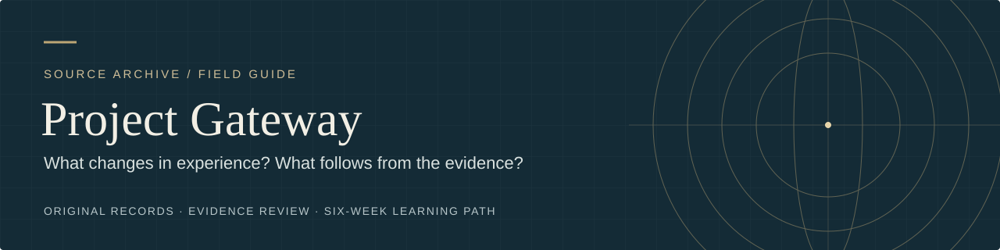

# Gateway Process — Evidence Review & Source Archive

How far can an image reach beyond the person who holds it? A 1983 Army memorandum approached that question through sound, altered states, and a universal hologram. Project Gateway preserves the record, examines the evidence, and offers a six-week course that reads the memorandum alongside Charles F. Haanel’s *The Master Key System*.

## Choose your path

| If you want to… | Go here |
|---|---|
| Get oriented | [Start here · 2–3 min](START_HERE.md) or look up a question in the [FAQ](FAQ.md) |
| Follow the course | [Six-week learning path](practice/LEARNING_PATH.md) · [Start on paper](practice/LEARNING_PATH.md#map-case) · [Case journal](practice/SESSION_JOURNAL_TEMPLATE.md) |
| Check what the research supports | [Evidence at a glance](research/EVIDENCE_AT_A_GLANCE.md) · [Source guide](research/SOURCES.md) |
| Read the 1983 memorandum | [Transcript and page navigation](transcript/03_Gateway_Process_Editable_Transcript.md) · [Source history and page 25](research/PROVENANCE_AND_EDITORIAL_NOTES.md) |
| Look up a term | [Glossary](research/GLOSSARY.md) |
| Read Haanel alongside Gateway | [The 24-part companion](research/MASTER_KEY_COMPANION.md) · [Comparison and independent evidence](research/HAANEL_AND_GATEWAY.md) |
| Explore Gateway’s audio, dreams, or concealed targets | [Optional explorations](practice/OPTIONAL_EXPLORATIONS.md) |

## What is this document?

Lt. Col. Wayne M. McDonnell submitted *Analysis and Assessment of Gateway Process* on 9 June 1983 within the U.S. Army Intelligence and Security Command. It attempts to explain the Monroe Institute’s Gateway Experience. The CIA later held and released a copy. Declassification made the record public. The strength of each explanation depends on its own evidence. [Government catalog](https://www.govinfo.gov/app/details/GOVPUB-D101-PURL-gpo152943) · [Editorial notes](research/PROVENANCE_AND_EDITORIAL_NOTES.md)

## What would count as a result?

An image might change how a situation feels or suggest a different next move. Discovering a concealed fact and directly influencing an event are two other claims, each with its own test. Haanel and McDonnell also ask what mind is. Their philosophical arguments give us questions to think through alongside the empirical ones. [Evidence map](research/EVIDENCE_AT_A_GLANCE.md#four-questions-to-keep-separate) · [Methodology](research/METHODOLOGY.md)

## Open the archive

| Resource | What you will find |
|---|---|
| [Government-preserved facsimile · PDF, 3.2 MB](source/01_Source_GovInfo_CIA_Release.pdf) | 29 scanned leaves; printed pages 17/18 are reversed and printed page 25 is absent |
| [Supplementary complete facsimile · PDF, 7.7 MB](source/02_Supplement_Complete_Copy_With_Page_25.pdf) | A separately sourced 30-leaf copy containing printed page 25 |
| [Editable transcript · Markdown](transcript/03_Gateway_Process_Editable_Transcript.md) | Reading order restored, original exhibits, and explicit page provenance |
| [Evidence review · Markdown](research/04_Gateway_Process_Evidence_Review_and_Learning_Guide.md) | Claim-by-claim discussion, linked citations, and study limitations |
| [Source guide](research/SOURCES.md) · [Structured inventory · JSON](research/05_Research_Source_Inventory.json) | Bibliographic records, access status, findings, and limits for the September review |

The reason page 25 is absent from the government copy is not established here. The omission is a provenance question; the supplementary page is labeled rather than silently substituted.

Word downloads and format notes

- [Transcript · Word](transcript/03_Gateway_Process_Editable_Transcript.docx)
- [Evidence review · Word](research/04_Gateway_Process_Evidence_Review_and_Learning_Guide.docx)

These preserve the September 2026 editions for readers who need the earlier text or an offline copy. Use the Markdown pages for current navigation and the facsimiles to check historical wording.

## Explore with a record

The course follows one everyday case from a first impression to a result you can check. Try it in quiet with your own case, or follow the story of a visitor who needs to find a meeting room. If you choose the exercises, read the practice guidance before you begin. [Learning path](practice/LEARNING_PATH.md) · [Before practice](practice/LEARNING_PATH.md#before-practice)

## Continue the inquiry

The roadmap identifies evidence that could change the assessment. The contribution guide explains how to connect a new source, correction, or reader report to a specific question. [Research roadmap](research/RESEARCH_ROADMAP.md) · [Contributing](CONTRIBUTING.md) · [Citation](CITATION.md) · [Licensing notes](LICENSE-NOTES.md)

**Edition:** the original literature review is dated 8 September 2026. The Haanel comparison has its own evidence notes and scope. See the [changelog](CHANGELOG.md), [repository audit](docs/REPOSITORY_AUDIT.md), and [maintenance guide](REPO_SETUP.md).
