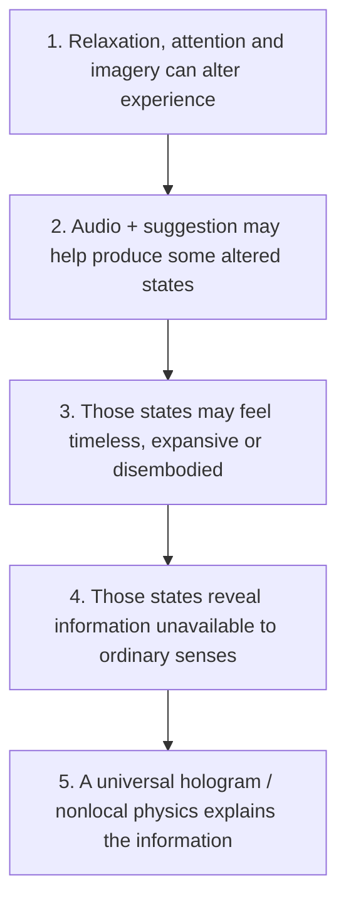

<div align="center">

# Gateway Process — Evidence Review & Source Archive

### A source-first guide to the 1983 U.S. Army *Analysis and Assessment of Gateway Process*

**Curiosity without credulity. Skepticism without dismissal.**

[Start here](START_HERE.md) ·
[Primary transcript](transcript/03_Gateway_Process_Editable_Transcript.md) ·
[Evidence review](research/04_Gateway_Process_Evidence_Review_and_Learning_Guide.md) ·
[Evidence at a glance](research/EVIDENCE_AT_A_GLANCE.md) ·
[Learning path](practice/LEARNING_PATH.md)

</div>

---

## What is this?

In June 1983, U.S. Army intelligence officer **Wayne M. McDonnell** wrote *Analysis and Assessment of Gateway Process*, an ambitious attempt to explain the Monroe Institute's Gateway Experience using ideas from meditation, hypnosis, biofeedback, binaural audio, neuroscience, physics, parapsychology, and religious philosophy.

The document later entered CIA archival holdings and was released through the CIA Reading Room. That history is frequently compressed online into claims that “the CIA proved” astral projection, remote viewing, manifestation, or a holographic universe.

That is **not what the record establishes**.

This repository keeps three things side by side:

1. **The historical source** — preserved scans and an editable transcript.
2. **The modern evidence review** — what later research supports, complicates, or contradicts.
3. **A disciplined way to explore the ideas** — without confusing a compelling experience with proof of its proposed mechanism.

> **One-sentence bottom line:** the experiential core of Gateway is plausible; evidence for binaural/Hemi-Sync effects is mixed and bounded; the memorandum's physical explanation is not a demonstrated theory; and extraordinary information claims such as remote viewing remain contested and operationally unreliable.

---

## Why this project exists

Gateway is unusually easy to misread because several very different questions are packed together:

- Can relaxation, attention, imagery, suggestion, vocalization, and repeated practice alter subjective experience? **Yes.**
- Can layered or binaural audio affect perception, physiology, or some psychological outcomes? **Sometimes; the evidence is mixed and method-dependent.**
- Can people sincerely experience timelessness, disembodiment, vivid imagery, or unusual self-location? **Yes.**
- Does that establish literal travel outside the body, access to hidden information, future events, or a universal information field? **No; those require separate tests.**
- Does the memorandum's physics demonstrate those mechanisms? **No.**

The project's rule is simple:

> **Respect the experience. Test the explanation. Verify the information.**

---

## The claim ladder

The 1983 memorandum effectively climbs a five-rung ladder. Evidence for a lower rung does not automatically support the ones above it.



The evidence is strongest near the top of this diagram and becomes progressively less secure as the argument moves from **experience** to **external information** to **cosmological mechanism**.

---

## Evidence at a glance

| Topic | Best-supported reading | What does **not** follow |
|---|---|---|
| Relaxation & focused attention | Mental and bodily state can change through breathing, attention, imagery, suggestion, and practice | Every Gateway “Focus” level is a unique, independently validated state |
| Binaural beats | Auditory responses occur; some studies report modest effects on pain, anxiety, or cognition | A beat percept automatically produces whole-brain synchrony or special knowledge |
| Hemi-Sync | Small clinical studies include both positive and null findings | Product-specific results validate the entire Gateway system |
| Left/right brain | Some functions are lateralized | Two opposing “brain personalities,” or an uncritical right hemisphere |
| Meditation / hypnosis / biofeedback | Useful for selected outcomes under defined conditions | Unlimited voluntary control of physiology |
| Out-of-body experience | Disembodiment and shifted self-location can be sincerely experienced | Awareness literally left the brain or perceived a hidden target |
| Lucid dreaming | Verified dreamers can sometimes communicate during REM sleep | Telepathy or consciousness outside the body |
| Remote viewing | Some studies and meta-analyses report nonchance effects | Reliable intelligence collection, a known mechanism, or consistent trainability |
| Schumann resonance | Earth-ionosphere electromagnetic modes are real | Similar frequency numbers create a human telepathy channel |
| Quantum / holographic language | Holography, entanglement, decoherence, and dualities are real scientific topics | Shared vocabulary validates cosmic memory, mind-over-matter, or faster-than-light mental signaling |
| “The Absolute” | A coherent philosophical or spiritual idea can be discussed | Physics has demonstrated eternal personal consciousness |

See [Evidence at a glance](research/EVIDENCE_AT_A_GLANCE.md) and the
[full review](research/04_Gateway_Process_Evidence_Review_and_Learning_Guide.md).

---

## A crucial historical correction

This is **not best described as “a CIA scientific report proving Gateway.”**

The visible memorandum is a **Department of the Army / U.S. Army Intelligence and Security Command** assessment written by Lt. Col. Wayne M. McDonnell on 9 June 1983. A copy was later held and released through CIA records.

Declassification establishes **provenance and public access**, not scientific endorsement.

For the source history, see [Provenance & editorial notes](research/PROVENANCE_AND_EDITORIAL_NOTES.md).

---

## The missing page 25

The government-preserved 29-leaf facsimile is missing **printed page 25**, and its printed pages 17 and 18 appear in reversed order.

This repository therefore keeps two source copies:

- [`01_Source_GovInfo_CIA_Release.pdf`](source/01_Source_GovInfo_CIA_Release.pdf) — the government-preserved release.
- [`02_Supplement_Complete_Copy_With_Page_25.pdf`](source/02_Supplement_Complete_Copy_With_Page_25.pdf) — a separately sourced complete facsimile used for the missing page.

The editable transcript restores pages 17/18 to reading order and clearly labels the separately sourced page 25. **The reason page 25 is absent from the government copy is not established by the sources here, so this project does not infer suppression from the omission alone.**

---

## Choose your path

| If you are… | Start with… | Then read… |
|---|---|---|
| Just curious | [START_HERE.md](START_HERE.md) | [Evidence at a glance](research/EVIDENCE_AT_A_GLANCE.md) |
| Interested in the original memo | [Editable transcript](transcript/03_Gateway_Process_Editable_Transcript.md) | [Provenance notes](research/PROVENANCE_AND_EDITORIAL_NOTES.md) |
| Evaluating the science | [Full evidence review](research/04_Gateway_Process_Evidence_Review_and_Learning_Guide.md) | [Methodology](research/METHODOLOGY.md) + [source inventory](research/05_Research_Source_Inventory.json) |
| Interested in altered states | [Glossary](research/GLOSSARY.md) | Sections on sleep, OBE, meditation, and audio in the evidence review |
| Interested in remote viewing | Remote-viewing section of the [evidence review](research/04_Gateway_Process_Evidence_Review_and_Learning_Guide.md) | [Research roadmap](research/RESEARCH_ROADMAP.md) |
| Interested in practicing | [Six-week learning path](practice/LEARNING_PATH.md) | [Session journal](practice/SESSION_JOURNAL_TEMPLATE.md) |
| Want to contribute | [CONTRIBUTING.md](CONTRIBUTING.md) | [Methodology](research/METHODOLOGY.md) |

---

## Repository map

```text
gateway-process-evidence/
│
├── README.md
├── START_HERE.md
├── FAQ.md
├── CONTRIBUTING.md
├── CITATION.md
├── CITATION.cff
├── LICENSE-NOTES.md
├── REPO_SETUP.md
│
├── source/
│   ├── 01_Source_GovInfo_CIA_Release.pdf
│   └── 02_Supplement_Complete_Copy_With_Page_25.pdf
│
├── transcript/
│   ├── 03_Gateway_Process_Editable_Transcript.md
│   ├── 03_Gateway_Process_Editable_Transcript.docx
│   └── figures/
│       ├── exhibit-1.png
│       ├── exhibit-2.png
│       ├── exhibit-3.png
│       ├── exhibit-4.png
│       └── exhibit-5.png
│
├── research/
│   ├── 04_Gateway_Process_Evidence_Review_and_Learning_Guide.md
│   ├── 04_Gateway_Process_Evidence_Review_and_Learning_Guide.docx
│   ├── 05_Research_Source_Inventory.json
│   ├── EVIDENCE_AT_A_GLANCE.md
│   ├── METHODOLOGY.md
│   ├── PROVENANCE_AND_EDITORIAL_NOTES.md
│   ├── GLOSSARY.md
│   └── RESEARCH_ROADMAP.md
│
├── practice/
│   ├── LEARNING_PATH.md
│   └── SESSION_JOURNAL_TEMPLATE.md
│
└── .github/
    └── ISSUE_TEMPLATE/
        ├── new-evidence.md
        └── source-or-transcript-correction.md
```

---

## What the project does **not** claim

This repository does not claim that:

- CIA or the U.S. Army scientifically established astral projection, remote viewing, manifestation, time travel, or survival after death.
- a subjective Gateway experience is “fake” because its proposed physics is unsupported.
- a positive laboratory effect automatically proves McDonnell's mechanism.
- a null paranormal result invalidates relaxation, imagery, meditation, or personal meaning.
- the evidence review is an exhaustive systematic review of every paper ever published on these topics.

The aim is narrower and more useful: **preserve the source, separate the claims, calibrate the evidence, and make the open questions testable.**

---

## A better way to explore Gateway

When something unusual happens in practice, ask three questions in order:

1. **What did I experience?**  
   Record sensation, imagery, emotion, time perception, self-location, and context before interpretation.

2. **What mechanism could explain it?**  
   Consider attention, expectation, sleep onset, imagery, vestibular/body representation, suggestion, auditory processing, physiology, and competing hypotheses.

3. **Did it reveal independently verifiable information?**  
   If the claim involves a concealed target, future event, distant location, or other external fact, test it prospectively and under blinding.

A vivid experience can be psychologically real without establishing a paranormal mechanism. A useful technique can remain useful even if the cosmology attached to it is wrong.

---

## Research philosophy

The repository uses three complementary reading modes:

- **Phenomenological** — What changes in attention, body sense, imagery, emotion, time sense, and identity?
- **Philosophical** — What view of mind, self, reality, knowledge, or death does the experience invite?
- **Empirical** — Which claims predict observations that can be independently measured and potentially falsified?

Confusion begins when a conclusion from one mode is imported into another without evidence.

See [Methodology](research/METHODOLOGY.md).

---

## Safety and practical use

Gateway-style exercises can be approached as structured relaxation, attention, imagery, and self-observation. They should not substitute for medical or mental-health care, and extraordinary impressions should not be used alone for medical, financial, legal, security, or high-stakes interpersonal decisions.

Meditation and relaxation are often well tolerated, but adverse experiences are documented. Keep sessions modest, protect sleep, and stop or scale back if practice is producing persistent anxiety, intrusive experiences, derealization, sleep disruption, or impaired daily functioning.

The practical materials in this repository emphasize **ordinary-life outcomes**: sleep, concentration, emotional regulation, completed actions, relationships, and clear thinking.

---

## Contributing

Corrections and new evidence are welcome — especially:

- better primary-source provenance,
- direct replications,
- preregistered studies,
- well-matched active-control trials,
- full-text sources that improve on abstract-only evidence,
- corrections to transcription or page-level sourcing,
- serious arguments either supporting **or challenging** the current assessment.

Please read [CONTRIBUTING.md](CONTRIBUTING.md) before opening a pull request.

The standard is not “does this support Gateway?” The standard is **“what, exactly, does this source allow us to conclude?”**

---

## Citation and rights

If you use this repository academically or publicly, cite the **original 1983 memorandum** for historical claims and the **specific modern sources** for scientific claims. See [CITATION.md](CITATION.md).

The U.S. government memorandum and the project's modern analysis have different rights considerations. No blanket license has been imposed on all material in this starter repository. See [LICENSE-NOTES.md](LICENSE-NOTES.md) before choosing a repository-wide license.

---

## Final orientation

The most interesting conclusion of the project is not that Gateway has been “proven” or “debunked.”

It is that a single 1983 document combines several layers that are still worth disentangling:

**altered experience → psychological technique → brain and body mechanism → anomalous information → philosophy of mind → metaphysics**

Some parts are ordinary and well supported. Some are plausible but under-tested. Some remain live scientific disputes. Some are philosophical. Some are simply bad physics.

Treating those categories separately makes the Gateway Process *more* interesting, not less.
