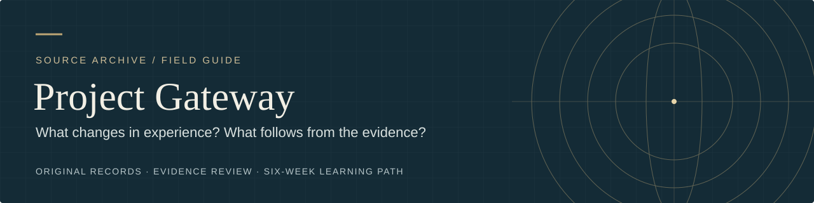

# Start here

[Home](README.md) · [Glossary](research/GLOSSARY.md) · [Learning path](practice/LEARNING_PATH.md)

**Read 2–3 minutes.** Meet the Gateway memorandum and choose a first reading or activity.

## The story in sixty seconds

In 1983, Army officer Wayne M. McDonnell tried to explain the Monroe Institute's Gateway training through psychology, neuroscience, physics, and metaphysics. His memorandum later entered CIA records. It is an **Army assessment**, not a CIA scientific finding; declassification is not endorsement.

The project keeps two questions open to inspection: what can people experience, and what does an experience establish about the world?

The [evidence review](research/04_Gateway_Process_Evidence_Review_and_Learning_Guide.md) finds:

- Attention, relaxation, imagery, suggestion, and repeated practice can alter experience.
- Audio research reports mixed, context-dependent effects; whole-brain synchronization is a separate, unsettled claim.
- The memorandum's physics does not demonstrate its proposed mechanism. It moves from metaphor to mechanism and even treats a length as a speed.
- Remote-viewing studies include positive findings and serious methodological disputes. Dependable operational use was not established in the reviewed intelligence program.

## Three questions to carry with you

> What did I experience? 
> What mechanism might explain it? 
> Did it reveal independently verifiable information?

A vivid experience can be worth understanding in its own right. An image may change a decision. A claim that it directly changed an outside event asks for a different kind of check. [Compare the claims](research/EVIDENCE_AT_A_GLANCE.md#four-questions-to-keep-separate)

## Choose your available time

| Time | Route | What you can take away |
|---|---|---|
| 3–5 minutes | [Evidence at a glance](research/EVIDENCE_AT_A_GLANCE.md) | Which claims are supported, contested, or still open |
| One topic at a time | [Review's opening matrix](research/04_Gateway_Process_Evidence_Review_and_Learning_Guide.md#executive-evidence-matrix), then one topic and its linked sources | A claim you can trace from summary to underlying evidence |
| Six short weekly lessons | [Learning path](practice/LEARNING_PATH.md) | Follow one case through attention, imagination, action, and a result you can check |
| A deeper reading | [The Master Key companion](research/MASTER_KEY_COMPANION.md) | Compare Haanel's 24 lessons with the Gateway memorandum at your own pace |

Reading estimates are guides, not deadlines. The complete transcript and review are longer reference works; use their contents to select a section.

## Read the original beside the analysis

Start with the [transcript's page navigation](transcript/03_Gateway_Process_Editable_Transcript.md). For a focused first reading:

1. Read §§ 5–10 on audio and resonance, then the [audio review](research/04_Gateway_Process_Evidence_Review_and_Learning_Guide.md#audio-entrainment-and-hemi-sync).
2. Read §§ 18–27 on time-space and out-of-body theory, then the [physics review](research/04_Gateway_Process_Evidence_Review_and_Learning_Guide.md#resonance-energy-holograms-and-quantum-physics).
3. Read §§ 28–33 on methods and information collection, then the [sleep and OBE discussion](research/04_Gateway_Process_Evidence_Review_and_Learning_Guide.md#sleep-lucid-dreams-and-out-of-body-experience).
4. Read § 38's proposed program, then the [research roadmap](research/RESEARCH_ROADMAP.md).

Use the [glossary](research/GLOSSARY.md) when a word carries several meanings. The [source guide](research/SOURCES.md) tells you whether the original review consulted a full paper, abstract, official summary, or partial record.

## Check the historical record

The [government PDF](source/01_Source_GovInfo_CIA_Release.pdf) has 29 leaves, reverses printed pages 17/18, and lacks printed page 25. The [supplementary PDF](source/02_Supplement_Complete_Copy_With_Page_25.pdf) has 30 leaves and supplies that page. Its separate provenance is preserved in the transcript. The sources do not establish why the page was omitted.

See [provenance and editorial notes](research/PROVENANCE_AND_EDITORIAL_NOTES.md) before drawing conclusions from archival gaps. Use [methodology](research/METHODOLOGY.md) to evaluate a scientific claim and [citation guidance](CITATION.md) to reference it.

**Next:** [Evidence at a glance](research/EVIDENCE_AT_A_GLANCE.md) or [Week 1](practice/LEARNING_PATH.md).
