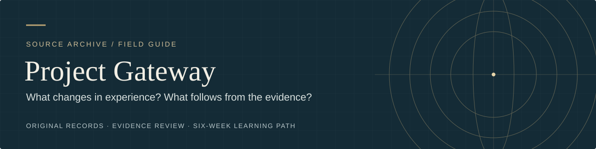

# Six-week Gateway learning path

[Start here](../START_HERE.md) · [Case journal](SESSION_JOURNAL_TEMPLATE.md) · [Master Key companion](../research/MASTER_KEY_COMPANION.md) · [Glossary](../research/GLOSSARY.md)

Imagine a first-time visitor following your map to a meeting room. They cross the lobby, turn at the stairs, and arrive on time. In your mind they are already inside. What did the image assume about the building?

Follow one small case across six weeks. Use attention and imagination, trace what changed, and check one result in the world. Read Charles F. Haanel's *The Master Key System* alongside Wayne M. McDonnell's *Analysis and Assessment of Gateway Process*. Both ask how consciousness shapes events. Their answers range from choices people make to claims about the nature of reality.

## Choose a route

- **Try it.** Read [Before practice](#before-practice), then [set up a small case](#preparation-before-week-1) and keep one [private record](SESSION_JOURNAL_TEMPLATE.md#case-record). A sketch or a few words can stand in for a mental image. Quiet works throughout.
- **On paper.** [Meet the map case](#map-case) and [start Week 1 on paper](#paper-week-1). Use the fictional details throughout. The exercises require no audio, special equipment, or personal disclosure.

Each week has a short orientation, a small task, and a question. Keep one record for your case. If you switch to a different case, mark the change and use the earlier prompts to fill in any context you need. Source passages and the companion are optional, with separate times. A missed session, a blank impression, or an unchecked result can go in the record as it stands.

## At a glance

| Week | Add to the record | Time after orientation |
|---|---|---|
| [1 · Stillness and choice](#week-1-stillness-and-choice) | An urge, a response, and one outcome to check | Try 5 min · Paper 3 min |
| [2 · Attention and release](#week-2-attention-and-release) | A distraction and what you returned to | Try 5 min · Paper 3 min |
| [3 · Remembering and inventing](#week-3-remembering-and-inventing) | A remembered detail checked against the original | Try 8 min · Paper 4 min |
| [4 · What can an image set in motion?](#week-4-what-can-an-image-set-in-motion) | A plan before and after imagining, an action, and the observed result | Try 10 min + action and 3–5 min later · Paper 5 min |
| [5 · Where did the answer come from?](#week-5-where-did-the-answer-come-from) | An idea, its possible source, and a check | Try 5 min + a break and check · Paper 4 min |
| [6 · Agency, service, and interpretation](#week-6-agency-service-and-interpretation) | A conclusion and one next check | Try or paper 8 min |

**Jump to paper activities** [Week 1](#paper-week-1) · [Week 2](#paper-week-2) · [Week 3](#paper-week-3) · [Week 4](#paper-week-4) · [Week 5](#paper-week-5) · [Week 6](#paper-week-6)

[Audio, sleep, and concealed-target explorations](OPTIONAL_EXPLORATIONS.md) are available alongside the six weeks.

## Before practice

Choose a safe, comfortable place. Keep breathing easy. Keep your eyes open or change position whenever you like. Practice when you can give the activity your attention and return to ordinary tasks comfortably.

Stop if distressed. Pause if anxiety, troubling detachment, disrupted sleep, or difficulty with daily tasks persists. Use ordinary routines and seek qualified support if the effects persist or worsen. Keep usual care in place. Check unusual impressions independently before making consequential decisions. See [practice guidance and safety sources](OPTIONAL_EXPLORATIONS.md#before-practice).

## Preparation before Week 1

**Try it · about 3 minutes.** Pick something small you can observe and revisit, such as a map, a work surface, or a set of instructions. Save a photo or a short description of how it is now. Write what you hope someone could do differently, and who or what could help you check. Use willing participants and agree on the task before involving anyone.

> **The map case.** A library volunteer wants a first-time visitor to find an evening meeting room unaided. They save their first map, which begins at the lobby, and invite a willing visitor to try it in Week 4. [Start Week 1 on paper](#paper-week-1)

## Week 1. Stillness and choice

**Orientation · 1 minute.** Haanel begins by asking a student to sit still while thoughts continue. He also proposes that each person expresses a universal consciousness. A short pause can show the difference between an urge and a movement. Consider what the experience could tell you about the subject who noticed both. [Parts 1–4](../research/MASTER_KEY_COMPANION.md#parts-1-4)

**Try it · 5 minutes.** Sit comfortably with your case in mind for up to one minute. Move if you need to. Record one sensation, urge, and response, or record what was absent. Write one observable outcome for your case. Give it a check you could do in Week 4.

**On paper · 3 minutes.** A library volunteer wants their map to guide a first-time visitor to an evening meeting room. The volunteer feels the chair, wants to reach for the draft, and waits until the minute ends. They decide to check whether a visitor reaches the room without asking for directions. Sort those details into sensation, urge, response, and outcome.

**Keep one line.** Which part could another person have observed, and what could only the person doing the exercise report? On paper, answer for the volunteer.

**Optional source reading · 2–3 minutes.** Haanel Part 1 ¶24–26 and ¶44–45. Read the preparation at the end of [Gateway §28](../transcript/03_Gateway_Process_Editable_Transcript.md#28-gateway-method).

## Week 2. Attention and release

**Orientation · 1 minute.** When Haanel asks students to inhibit thought, he expects thoughts to keep arriving. Later he introduces physical and mental release. McDonnell's preparation uses a pictured box to set concerns aside. This exercise keeps one concern available for later while you briefly return to a chosen detail. [Parts 1–4](../research/MASTER_KEY_COMPANION.md#parts-1-4)

**Try it · 5 minutes.** Write one question about the case. For a minute, look at one detail that could help answer it. When another concern appears, jot a word for it if useful, let it wait, and return to the detail. Note the concern and the first thing you noticed after returning. Keep the concern private.

**On paper · 3 minutes.** The volunteer means to look at the first turn on the map. They start thinking about tomorrow's agenda, write “agenda” on a separate page, and look back. They see that the stairs are drawn but the turn is unlabeled. Write what returned to attention and what continued as a separate concern.

**Keep one line.** What detail could you name after returning, and what did the return leave unresolved?

**Optional source reading · 2–3 minutes.** Haanel Part 2 ¶29–31 and Part 3 ¶29–33. Compare the sentence about the energy conversion box in [Gateway §28](../transcript/03_Gateway_Process_Editable_Transcript.md#28-gateway-method) and the first two sentences of [§29](../transcript/03_Gateway_Process_Editable_Transcript.md#29-hemi-sync-introduced).

## Week 3. Remembering and inventing

**Orientation · 1 minute.** Haanel moves from recalling a familiar place to studying a photograph and reconstructing it from memory. He later asks the reader to continue a remembered scene in imagination. Keep a remembered feature and a new idea on separate lines. [Parts 5–10](../research/MASTER_KEY_COMPANION.md#parts-5-10)

**Try it · 8 minutes.** Look at your photo, map, or original description for a minute. Put it away. Write or sketch one detail you think was there, then one detail you would add. Check the original. Record the exact match or discrepancy. Leave the proposed change labeled as an invention.

**On paper · 4 minutes.** Before reopening the map, the volunteer writes “stairs to the right of the lobby” and sketches a possible arrow at the turn. The map shows stairs to the left from the main entrance, with no arrow. Mark which statement was checked and which mark was a proposal.

**Keep one line.** Which detail did you record before looking, and what in the original settled it?

**Optional source reading · 2–3 minutes.** Haanel Part 5 ¶30, Part 6 ¶24–26, and Part 7 ¶31. These passages give the original exercises.

## Week 4. What can an image set in motion?

**Orientation · 1–2 minutes.** Haanel describes imagining a desired end and finding ways to act and people to work with. He also holds that the individual participates in the same creative Mind that formed the universe. He asks students to work backward from a finished battleship through the steel, labor, and decisions that put it afloat. Gateway's *patterning* holds an outcome as already achieved in the expanded awareness the program calls Focus 12. McDonnell proposes that the thought pattern interacts with a universal hologram and can help bring about an outcome that otherwise might never occur. [Parts 5–10](../research/MASTER_KEY_COMPANION.md#parts-5-10)

**Try it · 10 minutes, plus one small action and a later check.**

1. **Before you picture it · 2 min.** Write what will count as success, when you will check it, and the first move you would make now. *On Thursday evening, a first-time visitor reaches the room unaided. I would add the room number.*
2. **Enter the scene · 2 min.** Imagine, sketch, or describe the end as if it has happened. Record one detail and one assumption. Write down any change to your first move. *I pictured the visitor pausing at the stairs. I would add an arrow first. I assumed they could use the lobby after six.*
3. **Trace it backward · 6 min.** List three things the outcome depends on. Mark one you can act on and one you need to check. Write the move you will make, then do it. Keep the original criterion. *Recognize the room, find the turn, enter the building. I’ll add the arrow. The visitor's attempt will show whether the lobby works after six.*

**Check later · 3–5 minutes.** Record what happened before explaining why. Compare the first move you wrote before imagining, after imagining, and after tracing the causes. Identify one condition that mattered and one observation that could change your next move. If the check could not happen, write what prevented it.

**On paper · 5 minutes, or 6–7 with the orientation.** The volunteer initially plans to add the room number. Imagining the visitor pause at the stairs, they add an arrow instead. The check stays the same: the visitor will try to reach the room unaided on Thursday evening. At 6:10 p.m., the visitor finds the lobby door locked. A custodian shows them the side entrance. Once inside, the visitor sees the arrow and reaches the room. Did the original check succeed? Choose one fact to verify before revising the map again.

**Keep one line.** Where did the actual route first depart from the one imagined? In the map case, seeing the arrow tells us the visitor noticed it. To know whether the arrow was necessary, we would need a comparison with a route attempted without it.

**Consider the custodian.** On Haanel's account, the volunteer and custodian participate in the same Mind, and their choices still belong in the causal chain. McDonnell proposes that a projected thought can interact with a universal hologram and help bring about the outcome. [Optional comparison · 2–3 minutes for the opening](../research/HAANEL_AND_GATEWAY.md)

**Optional study question.** What could a comparison with and without patterning hold steady so that ordinary differences in action would be less likely to explain the result?

**Optional source reading · 5–7 minutes.** Haanel Part 7 ¶5–8 and Part 8 ¶28–33. Read “Patterning” in [Gateway §30B](../transcript/03_Gateway_Process_Editable_Transcript.md#30-advanced-techniques).

## Week 5. Where did the answer come from?

**Orientation · 1 minute.** Haanel describes intuition as arriving suddenly and attributes it to a source beyond memory and experience. McDonnell also expects some answers to arrive later, sometimes as an impression or symbol, and proposes that expanded consciousness can acquire information. A later idea can be useful. Its source is a separate question. [Parts 17–20](../research/MASTER_KEY_COMPANION.md#parts-17-20)

**Try it · 5 minutes, plus a break and check.** Pick one question left open by Week 4. Write what you already know, then do something ordinary. If an idea arrives, record it before looking up the answer. Mark what you think you knew beforehand, then check one detail against an accessible source. If nothing arrives, note that and take the next ordinary step.

**On paper · 4 minutes.** The volunteer asks where a first-time evening visitor should enter. Later, while washing a cup, they remember an “Evening entrance” sign near the side door. The volunteer had passed that sign on an earlier visit. The library's access notice lists that door as the designated evening entrance. Write what was remembered, what was already available, and what the notice independently confirms.

**Keep one line.** Which exact detail would have been surprising if you had never seen, heard, or inferred it before?

**Optional source reading · 3–4 minutes.** Haanel Part 17 ¶20–23 and Part 20 ¶19. Compare “Problem Solving” in [Gateway §30A](../transcript/03_Gateway_Process_Editable_Transcript.md#30-advanced-techniques) with the opening paragraph of [§33](../transcript/03_Gateway_Process_Editable_Transcript.md#33-information-collection-potential), where McDonnell raises information distortion.

## Week 6. Agency, service, and interpretation

**Orientation · 1–2 minutes.** Haanel asks what a desired object is for and treats service as a way of participating in a larger whole. McDonnell's account of the Absolute asks whether a person's consciousness can participate in a larger consciousness while retaining a distinct identity. The two accounts give you a reason to notice where individual action ends and cooperation begins. [Parts 21–24](../research/MASTER_KEY_COMPANION.md#parts-21-24)

**Try it or work on paper · 8 minutes.** Review your entries from Weeks 1–5. Mark one first-person report, one action, and one externally checked fact. Write the strongest account of what happened using those entries. Choose one idea from Haanel or McDonnell and say what it adds, such as a way to understand agency or a proposed effect that would need a separate comparison. Name one contribution from another person or material condition.

**On paper · 8 minutes.** The volunteer revises the map to start at the signed side entrance and keeps the arrow. The original visitor needed the custodian. The published access information supports the new route, and a first-time visitor has yet to try the revised map. Use the earlier map entries for the task above, then propose a next check.

**Keep one line.** Which observation changed your conclusion, and what one result would make you revise it again? End with a next step, or name the part you would leave unresolved.

**Optional source reading · 4–6 minutes.** Haanel Part 16 ¶1–6, Part 23 ¶1–5, and Part 24 ¶18–19 and ¶30–31. Read the opening discussion of memory and identity in [Gateway §27](../transcript/03_Gateway_Process_Editable_Transcript.md#27-consciousness-in-perspective).

## Optional explorations

[Simple comparison session](OPTIONAL_EXPLORATIONS.md#a-simple-comparison-session)

[Audio and expectancy](OPTIONAL_EXPLORATIONS.md#audio-and-expectancy)

[Sleep, dreams, and self-location](OPTIONAL_EXPLORATIONS.md#sleep-dreams-and-self-location)

[Information and independent verification](OPTIONAL_EXPLORATIONS.md#information-and-independent-verification)

[Concealed-target demonstration](OPTIONAL_EXPLORATIONS.md#optional-concealed-target-demonstration)

## Sources and limits

This is an educational workbook inspired by two historical texts. The suggested schedule is a pacing choice. Haanel's numbered paragraphs (¶) in the weekly assignments refer to the [modern edition PDF](https://www.thesecret.tv/wp-content/uploads/2015/04/Master-Key-System.pdf). The [companion](../research/MASTER_KEY_COMPANION.md) also links a transcription labeled 1919, where some paragraph numbers differ. The [evidence review](../research/04_Gateway_Process_Evidence_Review_and_Learning_Guide.md) distinguishes what has been studied from what the historical sources propose.
