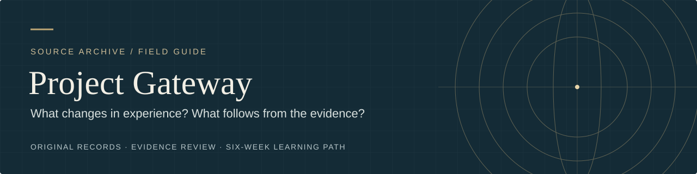

# The Master Key System · Reading companion

[Home](../README.md) · [Six-week course](../practice/LEARNING_PATH.md) · [Haanel and Gateway](HAANEL_AND_GATEWAY.md) · [Glossary](GLOSSARY.md)

Charles F. Haanel asks readers to sit still while their thoughts roam. Later, he asks them to picture a battleship and work backward through steel, shipbuilders, and public decisions. By the last lesson, he is asking what remains of a person beneath changing appearances. What does each exercise let the reader notice, and where does Haanel's explanation go beyond that observation?

Follow the 24 parts in order or pick up where a [Gateway course](../practice/LEARNING_PATH.md) lesson leaves you. Each entry gives you a passage to read and one question to carry into it. About **2–4 minutes** for each section of notes. The source passages and any practice take additional time. Reading alone is a complete route.

- [Parts 1–4](#parts-1-4) · Stillness, attention, and the directing self
- [Parts 5–10](#parts-5-10) · What images can do
- [Parts 11–16](#parts-11-16) · Conviction, inquiry, and action
- [Parts 17–20](#parts-17-20) · When an answer arrives
- [Parts 21–24](#parts-21-24) · Service, healing claims, and spiritual truth

**Editions.** The individual links open an online transcription labeled 1919. The modern edition hosted by *The Secret* updates some examples and sometimes numbers paragraphs differently. The ¶ references below follow the linked online text and refer to paragraphs in the lesson before the separately numbered study questions. The passages and exercises describe Haanel's historical course. For present-day practice, use the Gateway course's low-stakes adaptations. [Online contents](https://sacred-texts.com/book/the-master-key-system/start-reading) · [Modern edition PDF](https://www.thesecret.tv/wp-content/uploads/2015/04/Master-Key-System.pdf)

## Parts 1–4

Haanel separates bodily stillness, directed attention, muscular release, and mental release. McDonnell describes a different sequence, beginning with an imagined box for setting aside concerns and continuing through sound and relaxation. Both give a wandering mind a place in the practice. [Gateway §§28–29](../transcript/03_Gateway_Process_Editable_Transcript.md#28-gateway-method) · [Research on attention](HAANEL_AND_GATEWAY.md#attention-and-imagery)

### Part 1 · Stillness and choice

Haanel calls the individual an expression of a universal consciousness. His first exercise starts close to hand. Stay still and let thoughts come and go. If you notice an urge to move and choose how to respond, what have you learned about the urge and the choice? What further premise would connect that observation to one Universal Mind? [Part 1, ¶24–30 and ¶44–45](https://sacred-texts.com/book/the-master-key-system/part-one)

### Part 2 · What follows a thought

The book gathers habit, memory, bodily regulation, and intuition under *subconscious*. Its exercise asks readers to try to inhibit thought. Distinguish a thought arriving from the attention that follows it. At which of those moments does Haanel's gatekeeper analogy fit best? [Part 2, ¶23–31](https://sacred-texts.com/book/the-master-key-system/part-two)

### Part 3 · Body and attention

Haanel adds muscular release to stillness and proposes that the solar plexus connects the person with universal power. A change in felt tension gives one kind of observation. What would an independent observer need to detect to show the proposed connection? [Part 3, ¶1–13 and ¶29–33](https://sacred-texts.com/book/the-master-key-system/part-three)

### Part 4 · Who is directing?

Haanel distinguishes the spiritual *I* from body, thoughts, and personality. He pairs self-direction with mutual benefit, and the exercise asks the reader to release troubling preoccupations. Consider what changes if you treat an impulse as something you can notice before deciding how to respond. How does Haanel get from that distinction to an enduring self? [Part 4, ¶1–7 and ¶29–32](https://sacred-texts.com/book/the-master-key-system/part-four)

## Parts 5–10

The sequence moves from recalling a place to reconstructing a photograph, inventing a scene, tracing a cause, and changing an image on purpose. Gateway patterning also starts with an imagined end. McDonnell proposes that projecting the end in expanded awareness can affect what happens in the world. Keep track of when you are recalling, simulating, or making a claim about an external event. [Gateway §30B](../transcript/03_Gateway_Process_Editable_Transcript.md#30-advanced-techniques) · [What counts as evidence](HAANEL_AND_GATEWAY.md#what-each-claim-needs)

### Part 5 · Recalling a place

Haanel treats accumulated experience, habits, and surroundings as materials for the inner life. He asks the reader to reconstruct a familiar pleasant place and return to it over several days. Choose one detail you could check afterward. Would a vivid memory and an accurate one earn the same score? [Part 5, ¶1–14 and ¶29](https://sacred-texts.com/book/the-master-key-system/part-five)

### Part 6 · Reconstructing a photograph

The book likens attention to a lens. Study a photograph, put it away, and reconstruct it. When the original comes back into view, identify a detail you retained and one you supplied. A written description or a sketch can serve the same comparison. [Part 6, ¶19–26](https://sacred-texts.com/book/the-master-key-system/part-six)

### Part 7 · Inventing the next scene

The exercise begins with a remembered friend and then asks you to imagine a new response from them. Elsewhere in the same lesson, Haanel gives a chain from a defined ideal to an image, actions, methods, and people. Mark the point at which the remembered scene becomes invented, then identify a decision that an invented scene could help you make. [Part 7, ¶5–8 and ¶31](https://sacred-texts.com/book/the-master-key-system/part-seven)

### Part 8 · Working backward

Start from a battleship already afloat. Haanel follows it backward through its materials, design, financing, builders, and the conditions that let it float. If you take one person's intention out of that story, which conditions still shape what can happen? [Part 8, ¶28–33](https://sacred-texts.com/book/the-master-key-system/part-eight)

### Part 9 · A seed in motion

The exercise follows a flower from seed to bloom and asks the reader to imagine its scent. Earlier, Haanel uses a recovery testimonial to argue for affirmation. The flower offers a separate question about imagination. What conditions become visible when you picture the stages that a picture of the bloom alone would leave out? [Part 9, ¶18–28 and ¶32–33](https://sacred-texts.com/book/the-master-key-system/part-nine)

### Part 10 · Changing one feature

Haanel asks the reader to build a shape in stages and change its colors. He also distinguishes unfolding a potential from bringing a form into being. Pick one relationship in the figure, such as a point remaining centered. Can you retain it while changing another feature? [Part 10, ¶13–15 and ¶24](https://sacred-texts.com/book/the-master-key-system/part-ten)

## Parts 11–16

Haanel asks how certainty, feeling, and faith become action. He also asks readers to keep inconvenient facts in view. The tension comes into focus beside patterning. What does it mean to hold an end as fulfilled while leaving your account of events open to revision? [Gateway §30B](../transcript/03_Gateway_Process_Editable_Transcript.md#30-advanced-techniques) · [Research on imagining and planning](HAANEL_AND_GATEWAY.md#planning-and-action)

### Part 11 · The accomplished end

Haanel reads a passage about prayer as an instruction to conceive an end as already fulfilled. He also discusses discovering Neptune and making inventions. Consider trust in a religious practice, a prediction of something already there, and an idea leading to something built. What could a witness check in each case? [Part 11, ¶9–10, ¶16–20 (especially ¶18), and ¶35](https://sacred-texts.com/book/the-master-key-system/part-eleven)

### Part 12 · Whose will is at stake?

Haanel asks the reader to contemplate the individual as an expression of the whole. In the same lesson he cautions against séances, attempts at thought transfer, and using hypnosis to dominate another person's will. If an influence were possible, what would count as consent to it? [Part 12, ¶10–16 and ¶28](https://sacred-texts.com/book/the-master-key-system/part-twelve)

### Part 13 · An inconvenient fact

The lesson urges readers to keep observations that challenge their conclusions. It also invites them to contemplate the spiritual self as part of the whole and argues that the two share a nature. Which observation would prompt you to revise a practical belief? What further reasoning would you need to evaluate the claim about part and whole? [Part 13, ¶8–10 and ¶26–27](https://sacred-texts.com/book/the-master-key-system/part-thirteen)

### Part 14 · What is harmony?

Haanel asks readers to sustain attention on harmony and invokes electrons to link mind and matter. Test the idea of harmony in a minor disagreement on paper. What would withdrawal from rumination make easier to see, and what would withdrawing attention from the actual problem let you miss? [Part 14, ¶6–16 and ¶25–31](https://sacred-texts.com/book/the-master-key-system/part-fourteen)

### Part 15 · Insight that can be used

The lesson treats words as early forms of thought and defines insight in terms of seeing possibilities and obstacles. Haanel's exercise asks for a definite plan. Name an obstacle you could recognize as it happens and the first move you could take in response. [Part 15, ¶12–22 and ¶30–36](https://sacred-texts.com/book/the-master-key-system/part-fifteen)

### Part 16 · An object and what it is for

Haanel starts with wealth as a means of exchange, cautions against imagination escaping the facts, and ends with contemplation of harmony and happiness. Name one desired object, then describe the experience or contribution that would make it worth having. Would a different route serve the same end? [Part 16, ¶1–6 and ¶35–37](https://sacred-texts.com/book/the-master-key-system/part-sixteen)

## Parts 17–20

Both texts give sudden answers a place. Haanel describes intuition as independent of memory and experience. McDonnell describes a response arriving immediately or later, sometimes as a symbol, and proposes access through expanded consciousness. Compare the felt arrival, the usefulness of the answer, and the evidence about where its information came from. [Gateway §30A](../transcript/03_Gateway_Process_Editable_Transcript.md#30-advanced-techniques) · [Gateway §33](../transcript/03_Gateway_Process_Editable_Transcript.md#33-information-collection-potential) · [Research on intuition](HAANEL_AND_GATEWAY.md#intuition-and-concealed-information)

### Part 17 · Absorption without strain

Haanel compares concentration to an actor absorbed in a role, then asks readers to dwell on an ideal as present. If an answer seems to come all at once, record the first version and list what you already knew. Which part of the answer could you check separately from the feeling that it arrived suddenly? [Part 17, ¶3–10, ¶20–23, ¶33, and ¶37](https://sacred-texts.com/book/the-master-key-system/part-seventeen)

### Part 18 · Testing faith

Interest and attention feed each other in Haanel's account. He invites readers to put belief to a test, and his exercise compares spiritual life with breathing and seed growth. What would you predict before looking, and what would count against the prediction? [Part 18, ¶15–20 and ¶24–33](https://sacred-texts.com/book/the-master-key-system/part-eighteen)

### Part 19 · When an appearance misleads

Haanel treats apparent opposites as aspects of one whole and uses electrical polarity to argue for a universal substrate. The exercise begins with a misleading appearance. How would a second observer, a changed viewing angle, or a measurement help decide what happened? Which part of the mind-first interpretation would still be open? [Part 19, ¶4–16 and ¶25–29](https://sacred-texts.com/book/the-master-key-system/part-nineteen)

### Part 20 · Inspiration and cooperation

Haanel distinguishes inspiration from clairvoyance and cautions against trying to force the Universal. He closes with contemplation of divine immanence, the idea that the divine is present within ordinary existence. Can a felt insight change which responses you see as possible? What further check would be needed if it seemed to supply a fact? [Part 20, ¶14–19 and ¶27–31](https://sacred-texts.com/book/the-master-key-system/part-twenty)

## Parts 21–24

The final parts move between conduct, the conditions that make a life possible, and the nature of mind. Compare Haanel's spiritual self with McDonnell's account of the Absolute. McDonnell imagines a person retaining memory and identity in union while losing independent choice. What does each picture preserve about being a person? [Gateway §§23, 26–27](../transcript/03_Gateway_Process_Editable_Transcript.md#23-absolute-in-perspective) · [Comparison of the two accounts](HAANEL_AND_GATEWAY.md#the-individual-and-the-whole)

### Part 21 · What repetition does

Haanel says repeated impressions shape tendencies and allows recovery after lapses. He also extends spiritual equality into a critique of inherited political privilege. The exercise turns to Truth and the use of inner capacities. Where could a change in someone's habits help, and where would a change in rules or resources be needed? [Part 21, ¶8–17 and ¶24–28](https://sacred-texts.com/book/the-master-key-system/part-twenty-one)

### Part 22 · Nearness and healing

The exercise contemplates divine nearness through Tennyson. Elsewhere the lesson moves from familiar bodily effects to sweeping healing claims. Read those claims historically. What different observations would establish a person's sense of comfort, a change in symptoms, or an effect on a disease? [Part 22, ¶4–23 and ¶28–31](https://sacred-texts.com/book/the-master-key-system/part-twenty-two)

### Part 23 · Service and reciprocity

The exercise links money, service, and the spiritual self. In one success story, Haanel's narrator acknowledges never confirming the businessman's procedure with him. Whose account would show whether a service helped, and what information about resources or luck would the story need? The introduction describes the practice as lifelong. [Part 23, introduction and ¶14–22](https://sacred-texts.com/book/the-master-key-system/part-twenty-three)

### Part 24 · What kind of truth?

Haanel closes by asking the reader to consider wonder, awakening, and the difference between true and false. He gives inner consciousness a special authority in ¶19, then asks readers to weigh evidence in ¶30. Reread Part 13 alongside both passages. Which conclusion belongs to a spiritual or philosophical account, and which makes a prediction that another observer could check? [Part 24, ¶18–19 and ¶30–31](https://sacred-texts.com/book/the-master-key-system/part-twenty-four) · [Part 13, ¶8–10](https://sacred-texts.com/book/the-master-key-system/part-thirteen)

For a final entry, pick one claim and write down the passage, what you think it means, and what could change your reading. If you are also following the six-week course, compare it with a result from your case. [Return to the six-week course](../practice/LEARNING_PATH.md)
